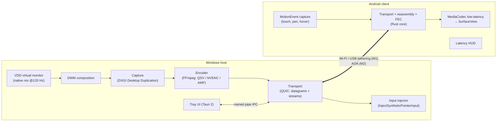

# Vetro — Architecture

> Turn an Android tablet into a wired or wireless extended monitor for a Windows PC, at the panel's native resolution and refresh rate, with measured glass-to-glass latency.
> Store name: **Vetro Display**. Decisions and their reasons live in [`docs/adr/`](docs/adr/); this file describes the system as it is meant to be built.

## 1. Scope

**In scope (MVP, milestone M1):** Windows 10 22H2+/11 host, Android 11+ client, one tablet at a time, extend mode, landscape, native resolution, touch + pen input, Wi-Fi and USB-tethering transports.

**Later:** AOA "plug and go" USB (M2), USB↔Wi-Fi failover (M3), v1.0 polish, v1.x quality features, Linux Wayland host (v2). See [`ROADMAP.md`](ROADMAP.md).

**Out of scope, permanently:** RAM/swap or compute offloading to the tablet, bidirectional audio mixing, USB+Wi-Fi bonding, X11 host. Reasons: [ADR-0013](docs/adr/0013-out-of-scope.md).

## 2. Glossary

| Term | Meaning |
|---|---|
| **Host** | The PC whose desktop is extended. Runs the engine and the tray UI. |
| **Client** | The Android tablet that shows the virtual monitor and sends input back. |
| **Engine** | `vetro-engine.exe`, the headless host process that owns the hot path. |
| **Hot path** | Capture → encode → send → receive → decode → present, plus input in reverse. Every millisecond here is budgeted. |
| **G2G** | Glass-to-glass latency: the same timer value appearing on the laptop panel and on the tablet panel. |
| **Damage** | The set of screen regions that changed since the last frame. No damage → no frame. |
| **VDD** | Virtual Display Driver (MIT), the third-party IddCx driver that creates the virtual monitor. |
| **AOA** | Android Open Accessory, a USB mode that needs no developer options on the tablet. |
| **HIL** | Hardware-in-the-loop test: the real tablet plugged into the real PC, driven by scripts. |

## 3. System overview



Two processes on the host, one app on the client. The engine never depends on the UI being open.

## 4. Latency budget

Targets per stage (p50) on the reference hardware (Galaxy Book2 Pro 360 i7-1260P/Iris Xe → Galaxy Tab S8 Ultra, 2960×1848 @120 Hz). The DWM composition wait is excluded because the G2G method (§11) compares against the laptop's own panel, which pays the same wait.

| Stage | Budget p50 | Measured by |
|---|---|---|
| Capture (DDA acquire → GPU frame ready for encoder) | ≤ 1.5 ms | host QPC timestamps |
| Encode (submit → bitstream out) | ≤ 5 ms | host |
| Transport (first fragment sent → last fragment received) | USB ≤ 1.5 ms · Wi-Fi ≤ 6 ms | synced clocks |
| Decode (queue input → output buffer) | ≤ 5 ms | client |
| Present (release → `OnFrameRendered`) | ≤ 5 ms (includes avg 4.2 ms vsync wait) | client |
| **Total** | **USB ≈ 18 ms · Wi-Fi ≈ 22.5 ms** | |

Service-level objectives (G2G): **USB p50 ≤ 20 ms, p99 ≤ 40 ms; Wi-Fi (5/6 GHz) p50 ≤ 30 ms, p99 ≤ 80 ms.** A change that worsens any stage's p99 by more than 10 % or 1 ms fails the performance gate.

## 5. Host components

### 5.1 Virtual display (VDD)
- The installer installs a pinned, signed VDD release (SHA-256 verified). The engine creates one virtual monitor per session with the client's exact mode (from the client's `Capabilities`), and removes it 10 s after disconnect (grace period, so a short Wi-Fi drop does not reshuffle windows).
- Control goes through VDD's own configuration interface; the exact mechanism (settings file + control pipe) is verified in the M1 spike and wrapped behind the `VirtualDisplay` trait.
- Render adapter: the encoder must run on the same GPU that renders the virtual monitor (zero-copy). On hybrid-GPU laptops the engine reads the adapter LUID of the VDD output and opens the encoder on that adapter.

### 5.2 Capture
- DXGI Desktop Duplication (`IDXGIOutput5::DuplicateOutput1`, BGRA8) on the VDD output only. The capture thread blocks in `AcquireNextFrame` and registers with MMCSS ("Capture").
- **Damage-driven:** `LastPresentTime == 0` means only the pointer moved → no video frame, only a cursor update. Empty dirty rects → no frame. A still desktop costs zero encode work.
- **Cursor:** pointer shape and position come from DDA separately and travel as cursor messages; the client draws the cursor as an overlay. Mouse movement over a still screen therefore needs no video frame at all.
- Colour conversion BGRA→NV12 happens on the GPU (encoder-native input or D3D11 VideoProcessor, whichever measures faster per vendor).
- Known MVP limits: the secure desktop (UAC prompts, lock screen) cannot be duplicated by an unprivileged process; the tablet holds the last frame and shows a banner.

### 5.3 Encoder
- FFmpeg (LGPL shared build, dynamically loaded) behind an `Encoder` trait. Backend chosen from the render adapter's vendor: Intel `hevc_qsv`/`av1_qsv`, NVIDIA `hevc_nvenc`/`av1_nvenc`, AMD `hevc_amf`/`av1_amf`, universal fallback `h264_mf`/`hevc_mf` (Media Foundation).
- Codec negotiation: best codec both sides support, in the order AV1 > HEVC > H.264. AV1 is labelled experimental until verified on real devices. Reference hardware uses HEVC Main 4:2:0 8-bit (Alder Lake cannot encode AV1, Snapdragon 8 Gen 1 cannot decode it).
- Low-latency settings, mandatory on every backend: no B-frames; one frame in flight (`async_depth=1` or equivalent); VBV ≈ one frame; infinite GOP with intra refresh where supported, IDR on demand otherwise; ultra-low-latency tuning (`tune=ull`/`zerolatency` NVENC, `usage=ultralowlatency` AMF, `low_power`+`low_delay_brc` QSV).
- Zero-copy: the DDA texture is wrapped as a D3D11 `AVFrame` on the same `ID3D11Device` (QSV frames derived from D3D11). No CPU readback anywhere on the hot path.
- The protocol reserves a "refinement" frame type for a later still-screen 4:4:4 colour pass ([ADR-0005](docs/adr/0005-encoding.md)).

### 5.4 Input injector
- Touch: `CreateSyntheticPointerDevice(PT_TOUCH, 10 contacts)`; pen: `CreateSyntheticPointerDevice(PT_PEN, 1)`; events via `InjectSyntheticPointerInput` with pressure, tilt, rotation, hover (in-range without contact), barrel and eraser buttons.
- Coordinates arrive normalised to [0, 1] of the virtual monitor and are mapped to its desktop rectangle in physical pixels (engine is Per-Monitor-V2 DPI aware; rectangle refreshed on `WM_DISPLAYCHANGE`).
- Runs on its own high-priority thread fed by its own QUIC stream, never queued behind video.
- MVP runs unprivileged: injection into elevated windows is blocked by UIPI. A privileged Windows service lifts this in v1.0.

### 5.5 Engine process and tray UI
- `vetro-engine.exe`: headless, single instance, user session, autostart through the per-user Run key. CLI flags for tests: `--test-pattern <name>`, `--no-vdd` (synthetic source, no driver), `--telemetry-out <file.jsonl>`, `--bind <addr>`.
- `Vetro.exe`: Tauri 2 tray app (status, pairing QR, paired devices, settings). Talks to the engine over a local named pipe (`\\.\pipe\vetro-engine`, ACL: current user) with JSON-RPC. Closing the UI never affects streaming.

## 6. Client components

### 6.1 Android app (Kotlin)
- Jetpack Compose for pairing, device list and settings. QR scanning with CameraX + ZXing (Apache-2.0), so the app stays F-Droid compatible: no Google Play Services anywhere.
- `StreamActivity`: immersive full-screen `SurfaceView`, screen kept on, `Surface.setFrameRate(refresh, FRAME_RATE_COMPATIBILITY_FIXED_SOURCE)` plus `preferredDisplayModeId` to hold the panel at its maximum refresh.
- Input: `onTouchEvent`/`onGenericMotionEvent` with `requestUnbufferedDispatch` (full sensor rate, no per-frame batching) → JNI → Rust. Palm rejection and system cancels are forwarded as cancels. `setSystemGestureExclusionRects` reduces edge-swipe conflicts with gesture navigation (Android caps this; documented limitation).
- Latency HUD overlay toggled by a three-finger tap.

### 6.2 Client core (Rust `cdylib`)
- Same `vetro-protocol` and `vetro-transport` crates as the host: the protocol is implemented once.
- Reassembly and FEC, then NDK `AMediaCodec` in async mode, output straight to the `ANativeWindow` of the `SurfaceView` (zero-copy).
- Decoder configuration: `KEY_LOW_LATENCY=1`, `KEY_PRIORITY=0`, high `KEY_OPERATING_RATE`, plus vendor low-latency keys when the codec lists them (e.g. Qualcomm `vendor.qti-ext-dec-low-latency.enable`). Each access unit is queued as soon as it is complete; output buffers are released for rendering immediately (latency-first presentation, [ADR-0010](docs/adr/0010-android-client.md)).
- `OnFrameRenderedListener` gives the real render time for telemetry.

## 7. Protocol

ALPN `vetro/1`. Serialisation: `postcard` (serde, varint) with explicitly tagged, append-only enums; unknown tags are rejected, never guessed. The version is negotiated in `Hello`; one major version is supported at a time until v1.0.

| Channel | QUIC primitive | Direction | Content |
|---|---|---|---|
| Control | bidirectional stream 0 | both | `Hello`, `Capabilities`, `Configure`, `KeyframeRequest`, `ClockSync`, cursor shape, `Bye` |
| Input | unidirectional stream, highest priority | client → host | touch/pen/hover events, batched per send |
| Video | datagrams | host → client | frame fragments |
| Cursor position | datagrams, latest wins | host → client | position + visibility |
| Telemetry | unidirectional stream, lowest priority | both | per-frame timestamps, loss, bitrate feedback |

**Session:** discover (mDNS `_vetro._udp`) → connect (mutual TLS, pinned) → `Hello`/`Capabilities` (client: resolution, refresh, density, decoders with profiles; host: encoders) → `Configure` (codec, mode, bitrate) → engine creates the virtual monitor → stream → `Bye` or timeout → 10 s grace → monitor removed.

**Video framing:** each encoded frame is split into fragments that fit the path's max datagram size. Fragment header: `frame_id u32`, `frag_index u16`, `frag_count u16`, `fec_parity u8`, `flags u8` (keyframe, refinement), `capture_ts_us u64` (host clock). Reed–Solomon parity per frame: 0 % on USB, adaptive 5–25 % on Wi-Fi from measured loss.

**Loss recovery:** no retransmission of video. A frame whose fragments are not complete one frame-interval after its first fragment is dropped; the client sends `KeyframeRequest` (rate-limited) and the host answers with an intra-refresh cycle or an IDR.

### 7.1 Wire details (fixed in M1-2, `crates/vetro-protocol`)

- **Streams** (control, input, telemetry) carry frames `[len: u32 LE][postcard message]`, one top-level enum per stream (`ControlMessage`, `InputMessage`, `TelemetryMessage`). Limits per message: control 512 KiB (room for a 256 × 256 RGBA cursor), input 16 KiB (≤ 256 events per batch), telemetry 1 KiB. A length over the limit, an unknown tag, trailing bytes or an out-of-range field closes the stream. Encoding validates too, so a side never sends what the peer would reject. postcard accepts overlong varints; they decode to the same value, and re-encoding gives the canonical form.
- **Versioning:** `Hello` is tag 0 of `ControlMessage` and starts with `Version { major, minor }`; both are frozen forever so every build can read every other build's `Hello`. The major is also in the ALPN (`vetro/<major>`). Same major required; the session runs at the lower minor; on mismatch the detecting side sends `Bye { VersionMismatch }`.
- **Evolution rules** (postcard is not self-describing and decoding rejects trailing bytes): structs are frozen within a major, so no field is added, removed, reordered or retyped (tests pin the bytes of `Hello` and `Configure`). A minor may only append enum variants, and a test pins every tag. Each side sends only `Hello` until the peer's `Hello` has arrived; after that it sends a variant added in minor *m* only when the negotiated minor is ≥ *m*.
- **Pairing token:** the client sends the QR's one-time token in `Hello.pair_token` on the first connection ([ADR-0008](docs/adr/0008-security-pairing.md)); its `Debug` output is redacted and its `==` is constant time.
- **Clock sync** is two messages, `ClockSyncRequest { seq, client_send_us }` and `ClockSyncResponse` (adds `host_recv_us`, `host_send_us`).
- **Cursor:** `CursorShape` on the control stream is straight-alpha RGBA8 (the host converts DDA monochrome/masked shapes), at most 256 × 256; `CursorPosition { seq, x, y, visible }` on datagrams, latest `seq` wins.
- **Input** uses fixed point, never floats (no NaN on the wire): position and pressure `u16` (0..=65535 across the range), tilt `i8` degrees −90..=90, rotation `u16` degrees 0..360, buttons bit set (barrel, secondary), client timestamps in µs.
- **Datagrams** start with a kind byte: `0` video fragment, `1` cursor position. The video fragment header is a fixed 18-byte little-endian layout (fields in the order listed above), not postcard, so every fragment of a frame has the same size and the payload size follows from the path MTU (overhead 19 bytes). `frag_count` counts data + parity; the last `fec_parity` fragments are parity. Unknown flag bits are rejected.
- **Frame layout:** the data fragments carry `[frame_len: u32 LE][frame][zero padding]` in equal, even-sized shards (Reed–Solomon over GF(2¹⁶), `reed-solomon-simd`). Parity count = ⌈data × percent / 100⌉, capped at 255, so any non-zero percentage survives at least one loss.
- **Limits:** ≤ 8192 fragments per frame, ≤ 65 534 payload bytes per fragment, ≤ 8 MiB per frame (data + parity).
- **Reassembly** bounds memory against a hostile peer: ≤ 4 frames in flight (configurable 1–16), each ≤ the frame limit. Frames are delivered in completion order; when a frame completes, older incomplete frames are dropped (they could only be decoded out of order); a full set of slots evicts the oldest frame; fragments of a frame that already completed or was dropped are ignored. Every drop counts as a lost frame, and so does every frame id skipped entirely (not one fragment arrived). The client sends `KeyframeRequest` with the newest lost id. The frame buffers stay within `max_in_flight × (frame limit + 8192)` bytes; on top of that, the Reed–Solomon decoder work space is sized from one frame, so it is bounded by a small multiple of the frame limit.
- **Frame numbering invariant:** the host numbers frames +1 per frame for the whole connection, also across encoder resets and IDRs. As a safety net, a new frame id more than 64 frames *older* than the newest finished one is taken as a numbering restart: the client drops everything in flight, starts over and requests a keyframe. A smaller backwards step is a late fragment and is ignored.

**Rate control:** delay-based. The client reports one-way-delay gradient and loss on the telemetry stream; the host lowers the encoder bitrate before queues build up. QUIC's own congestion controller is replaced by a permissive custom controller so that it never queues video behind a download-style window.

## 8. Security

Threats considered: passive sniffing and active MITM on the LAN; an unpaired device connecting and injecting input (= remote control of the PC); malformed packets against the parsers; a lost tablet.

- Host and client each hold a long-term key pair and self-signed certificate, generated locally (`rcgen` + `rustls`).
- **Pairing:** the tray UI shows a QR code `vetro://pair?fp=<host cert SHA-256>&t=<128-bit one-time token>&a=<addresses>&p=<port>`. The client verifies the host fingerprint from the QR, presents its own certificate and sends the token; the host checks the token (single use, 5-minute TTL) and pins the client fingerprint.
- **Every connection** after pairing is mutual TLS with pinned fingerprints, on every transport including USB. There is no unauthenticated or "fast insecure" mode.
- Parsers are safe Rust with explicit length limits, covered by property tests and a fuzz target.
- Unpairing from the tray UI revokes a device immediately.
- No telemetry leaves the PC; diagnostics export is a manual button.

## 9. Transports

| Transport | Milestone | Notes |
|---|---|---|
| Wi-Fi (LAN) | M1 | Client holds `WIFI_MODE_FULL_LOW_LATENCY`. 2.4 GHz is shown as "not recommended". |
| USB tethering | M1 | IP over USB (RNDIS/NCM), same code as Wi-Fi. The tablet must offer USB tethering (verified in M0). The engine detects the tethering interface and must keep it from becoming the PC's default route (fix verified in M1). |
| AOA | M2 | QUIC packets carried over USB bulk endpoints through a custom `quinn` socket adapter; no developer options, app opens on plug. Needs a one-time admin driver install on Windows (WinUSB INF for the accessory interface + a start helper); conditional on the M2 pre-spike, see [ADR-0016](docs/adr/0016-aoa-on-windows.md). |
| Failover | M3 | Both paths kept warm; QUIC connection migration; 100–300 ms glitch + keyframe on switch. No bonding. |

## 10. Real-time rules for the hot path

- Bounded queues of capacity 1–2 between stages; when full, drop the oldest frame (fresh beats complete).
- No blocking I/O, no locks shared with the UI, no logging on hot-path threads: telemetry goes to a lock-free ring buffer drained by a cold thread.
- Allocate per-frame buffers from pools set up at session start. In `vetro-protocol`, the fragmenter's datagram buffer, the reassembler's frame slots and the Reed–Solomon work spaces grow to their high-water mark during the first frames and are reused afterwards: steady-state fragmenting and reassembly allocate nothing.
- Thread priorities: MMCSS on the host capture/encode/input threads; `THREAD_PRIORITY_URGENT_DISPLAY` for the client decode thread.
- Every new dependency on the hot path needs a measured before/after in its PR.

## 11. Telemetry and measurement

- Every frame carries `capture_ts_us`; the client records receive-complete, decode-in, decode-out and rendered times. Clocks are aligned with an NTP-style exchange on the control stream every second (minimum-RTT filter; error ≈ RTT/2, under 0.5 ms on USB).
- Per-stage HDR histograms feed the HUD and a JSONL export.
- **HIL run** (`tools/hil/`): build, install the APK, start the engine with a scripted test pattern for N seconds, pull both telemetry files, compute p50/p95/p99 per stage, compare with `bench/baseline.json`, write a Markdown summary and post it to the milestone's tracking issue. A run is valid only on AC power, after ≥ 10 min of user inactivity and with CPU load < 20 %; otherwise it is marked **noisy** and never used as a gate.
- **G2G truth** at each milestone: a timer page (`tools/latency-timer.html`) is shown on both the laptop panel and the virtual monitor; 20+ high-speed photos or a 240 fps clip give the difference per sample.

## 12. Platform abstraction

Traits defined from day one, one implementation each in the MVP: `VirtualDisplay`, `Capture`, `Encoder`, `InputInjector`, `Transport` socket. Windows code lives in `platform::windows` modules behind `cfg(windows)`. The Linux Wayland host (v2) adds a second implementation of each trait (PipeWire capture, VAAPI encode, compositor virtual outputs, RemoteDesktop portal/libei input) without touching the protocol.

## 13. Repository layout

```text
vetro/
├─ Cargo.toml                 # workspace, edition 2024, MSVC toolchain on Windows
├─ crates/
│  ├─ vetro-protocol/         # messages, framing, FEC, versioning — no I/O, platform-independent
│  ├─ vetro-transport/        # quinn setup, pinned mTLS, pairing, custom CC, socket adapters
│  ├─ vetro-encode/           # Encoder trait + FFmpeg backends
│  ├─ vetro-engine/           # host binary: capture, VDD control, input injection, IPC, telemetry
│  └─ vetro-client/           # Android cdylib: transport, reassembly, AMediaCodec, input, JNI
├─ apps/tray/                 # Tauri 2 tray UI
├─ android/                   # Gradle project (Kotlin + Compose), loads libvetro_client.so
├─ tools/                     # fetch-ffmpeg, HIL harness, latency timer page, idle guard
├─ bench/                     # baselines and published results
├─ docs/                      # adr/, milestones/, manual-tests/, it/GUIDA.md
├─ ARCHITECTURE.md  ROADMAP.md  CLAUDE.md  README.md
```

## 14. Build and toolchain

- Rust stable, MSVC target on Windows (requires Visual Studio 2022 Build Tools, C++ workload). Android via `cargo-ndk` for `aarch64-linux-android` (plus `x86_64` for the emulator), NDK 28.
- FFmpeg: `tools/fetch-ffmpeg.ps1` downloads a pinned BtbN LGPL shared build, verifies its SHA-256, unpacks to `third_party/ffmpeg/` (git-ignored) and prints the command that sets `FFMPEG_DIR`. Only LGPL builds are ever shipped; GPL-only encoders (x264/x265) are never linked.
- Android: AGP with JDK 17, `minSdk 30`, latest `targetSdk`.
- Release signing: Windows binaries and installer signed in CI through SignPath Foundation; APK signed with the project release key stored as a CI secret.

## 15. Testing strategy

| Layer | What | Where |
|---|---|---|
| Unit | every crate; protocol round-trips | CI (Windows + Linux) |
| Property + fuzz | protocol parsers, fragment reassembly, FEC | CI Linux (fuzz smoke), longer runs nightly |
| Integration | synthetic source → encoder → QUIC over loopback → software decode, checking frame order and checksums | CI Windows |
| Client core | Rust client against a mock decoder on x86 | CI |
| HIL | real tablet + real PC, per-stage percentiles, performance gate | local, nightly or on demand |
| Manual | checklists in `docs/manual-tests/` (physical steps by the owner, on-screen steps by Antigravity) | once per milestone |

CI also runs `cargo fmt --check`, `cargo clippy -D warnings`, `cargo deny` (licence allowlist: MIT, Apache-2.0, BSD, ISC, Zlib, Unicode, MPL-2.0) and `cargo audit`.

## 16. Compatibility

| Host GPU | Encoders used |
|---|---|
| Intel Gen9+ iGPU / Arc | QSV: H.264, HEVC; AV1 on Arc and Core Ultra |
| NVIDIA GTX 900+ / RTX | NVENC: H.264, HEVC; AV1 on RTX 40+ |
| AMD RX 400+ / Ryzen APU | AMF: H.264, HEVC; AV1 on RX 7000 / Ryzen 7040+ |
| Anything else | Media Foundation fallback |

Client: any Android 11+ device with a hardware H.264/HEVC decoder. AV1 needs e.g. Snapdragon 8 Gen 2+, Google Tensor or recent Dimensity.

## 17. Risks and open questions

| # | Risk | Resolved in |
|---|---|---|
| R1 | Iris Xe may not sustain HEVC 2960×1848 @120 fps within the 5 ms encode budget, or may throttle in a 30-minute soak | M0 (FFmpeg `ddagrab` + `hevc_qsv` spike, Apollo baseline), M1 soak |
| R2 | A Wi-Fi-only Tab S8 Ultra may not offer USB tethering at all | M0 (check on device) |
| R3 | USB tethering can steal the PC's default route; fixing the interface metric may need admin rights | M1 |
| R4 | AOA on Windows needs WinUSB bound to `18D1:2D00/2D01` and a way to send the AOA start requests | M0-7: does not work on a stock PC without developer options and a driver install ([ADR-0016](docs/adr/0016-aoa-on-windows.md), Proposed); M2 pre-spike |
| R5 | VDD control interface, mode-switch time, DWM honouring 120 Hz on the virtual monitor | M1 spike |
| R6 | QUIC overhead or pacing vs raw UDP | M1 measurement; exit plan in [ADR-0006](docs/adr/0006-transport-quic.md) |
| R7 | Samsung adaptive refresh honouring `setFrameRate` at 120 Hz | M1 |
| R8 | Gesture navigation stealing edge swipes | M1 (documented limitation) |
| R9 | FFmpeg D3D11→QSV zero-copy latency and stability | M1 spike; fallback: native oneVPL backend behind the `Encoder` trait |
| R10 | Content on a secondary 120 Hz virtual monitor may render at the primary panel's 60 Hz (seen with Edge in the M0 baseline), which would cap the stream and blind the §11 timer method | M0-5 check while VDD is installed, recorded in M0-8 |
