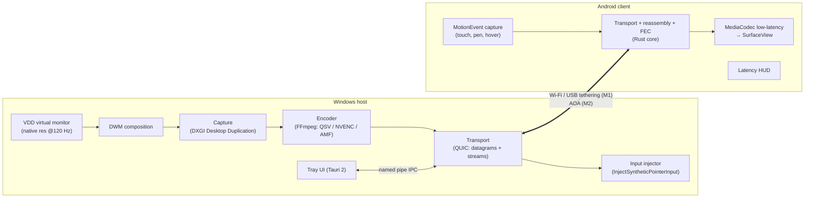

# Vetro — Architecture

> Turn an Android tablet into a wired or wireless extended monitor for a Windows PC, at the panel's native resolution and refresh rate, with measured glass-to-glass latency.
> Store name: **Vetro Display**. Decisions and their reasons live in [`docs/adr/`](docs/adr/); this file describes the system as it is meant to be built.

## 1. Scope

**In scope (MVP, milestone M1):** Windows 10 22H2+/11 host, Android 11+ client, one tablet at a time, extend mode, landscape, native resolution, touch + pen input, Wi-Fi and USB-tethering transports.

**Later:** AOA "plug and go" USB (M2), USB↔Wi-Fi failover (M3), v1.0 polish, v1.x quality features, Linux Wayland host (v2). See [`ROADMAP.md`](ROADMAP.md).

**Out of scope, permanently:** RAM/swap or compute offloading to the tablet, bidirectional audio mixing, USB+Wi-Fi bonding, X11 host. Reasons: [ADR-0013](docs/adr/0013-out-of-scope.md).

## 2. Glossary

| Term | Meaning |
|---|---|
| **Host** | The PC whose desktop is extended. Runs the engine and the tray UI. |
| **Client** | The Android tablet that shows the virtual monitor and sends input back. |
| **Engine** | `vetro-engine.exe`, the headless host process that owns the hot path. |
| **Hot path** | Capture → encode → send → receive → decode → present, plus input in reverse. Every millisecond here is budgeted. |
| **G2G** | Glass-to-glass latency: the same timer value appearing on the laptop panel and on the tablet panel. |
| **Damage** | The set of screen regions that changed since the last frame. No damage → no frame. |
| **VDD** | Virtual Display Driver (MIT), the third-party IddCx driver that creates the virtual monitor. |
| **AOA** | Android Open Accessory, a USB mode that needs no developer options on the tablet. |
| **HIL** | Hardware-in-the-loop test: the real tablet plugged into the real PC, driven by scripts. |

## 3. System overview



Two processes on the host, one app on the client. The engine never depends on the UI being open.

## 4. Latency budget

Targets per stage (p50) on the reference hardware (Galaxy Book2 Pro 360 i7-1260P/Iris Xe → Galaxy Tab S8 Ultra, 2960×1848 @120 Hz). The DWM composition wait is excluded because the G2G method (§11) compares against the laptop's own panel, which pays the same wait.

| Stage | Budget p50 | Measured by |
|---|---|---|
| Capture (DDA acquire → GPU frame ready for encoder) | ≤ 1.5 ms | host QPC timestamps |
| Encode (submit → bitstream out) | ≤ 5 ms | host |
| Transport (first fragment sent → last fragment received) | USB ≤ 1.5 ms · Wi-Fi ≤ 6 ms | synced clocks |
| Decode (queue input → output buffer) | ≤ 5 ms | client |
| Present (release → `OnFrameRendered`) | ≤ 5 ms (includes avg 4.2 ms vsync wait) | client |
| **Total** | **USB ≈ 18 ms · Wi-Fi ≈ 22.5 ms** | |

Service-level objectives (G2G): **USB p50 ≤ 20 ms, p99 ≤ 40 ms; Wi-Fi (5/6 GHz) p50 ≤ 30 ms, p99 ≤ 80 ms.** A change that worsens any stage's p99 by more than 10 % or 1 ms fails the performance gate.

## 5. Host components

### 5.1 Virtual display (VDD)
- The installer installs a pinned, signed VDD release (SHA-256 verified). The engine creates one virtual monitor per session with the client's exact mode (from the client's `Capabilities`), and removes it 10 s after disconnect (grace period, so a short Wi-Fi drop does not reshuffle windows).
- Control goes through VDD's own configuration interface; the exact mechanism (settings file + control pipe) is verified in the M1 spike and wrapped behind the `VirtualDisplay` trait.
- Render adapter: the encoder must run on the same GPU that renders the virtual monitor (zero-copy). On hybrid-GPU laptops the engine reads the adapter LUID of the VDD output and opens the encoder on that adapter.

### 5.2 Capture
- DXGI Desktop Duplication (`IDXGIOutput5::DuplicateOutput1`, BGRA8) on the VDD output only. The capture thread blocks in `AcquireNextFrame` and registers with MMCSS ("Capture").
- **Damage-driven:** `LastPresentTime == 0` means only the pointer moved → no video frame, only a cursor update. Empty dirty rects → no frame. A still desktop costs zero encode work.
- **Cursor:** pointer shape and position come from DDA separately and travel as cursor messages; the client draws the cursor as an overlay. Mouse movement over a still screen therefore needs no video frame at all.
- Colour conversion BGRA→NV12 happens on the GPU (encoder-native input or D3D11 VideoProcessor, whichever measures faster per vendor).
- Known MVP limits: the secure desktop (UAC prompts, lock screen) cannot be duplicated by an unprivileged process; the tablet holds the last frame and shows a banner.

### 5.3 Encoder
- FFmpeg (LGPL shared build, dynamically loaded) behind an `Encoder` trait. Backend chosen from the render adapter's vendor: Intel `hevc_qsv`/`av1_qsv`, NVIDIA `hevc_nvenc`/`av1_nvenc`, AMD `hevc_amf`/`av1_amf`, universal fallback `h264_mf`/`hevc_mf` (Media Foundation).
- Codec negotiation: best codec both sides support, in the order AV1 > HEVC > H.264. AV1 is labelled experimental until verified on real devices. Reference hardware uses HEVC Main 4:2:0 8-bit (Alder Lake cannot encode AV1, Snapdragon 8 Gen 1 cannot decode it).
- Low-latency settings, mandatory on every backend: no B-frames; one frame in flight (`async_depth=1` or equivalent); VBV ≈ one frame; infinite GOP with intra refresh where supported, IDR on demand otherwise; ultra-low-latency tuning (`tune=ull`/`zerolatency` NVENC, `usage=ultralowlatency` AMF, `low_power`+`low_delay_brc` QSV).
- Zero-copy: the DDA texture is wrapped as a D3D11 `AVFrame` on the same `ID3D11Device` (QSV frames derived from D3D11). No CPU readback anywhere on the hot path.
- The protocol reserves a "refinement" frame type for a later still-screen 4:4:4 colour pass ([ADR-0005](docs/adr/0005-encoding.md)).

### 5.4 Input injector
- Touch: `CreateSyntheticPointerDevice(PT_TOUCH, 10 contacts)`; pen: `CreateSyntheticPointerDevice(PT_PEN, 1)`; events via `InjectSyntheticPointerInput` with pressure, tilt, rotation, hover (in-range without contact), barrel and eraser buttons.
- Coordinates arrive normalised to [0, 1] of the virtual monitor and are mapped to its desktop rectangle in physical pixels (engine is Per-Monitor-V2 DPI aware; rectangle refreshed on `WM_DISPLAYCHANGE`).
- Runs on its own high-priority thread fed by its own QUIC stream, never queued behind video.
- MVP runs unprivileged: injection into elevated windows is blocked by UIPI. A privileged Windows service lifts this in v1.0.

### 5.5 Engine process and tray UI
- `vetro-engine.exe`: headless, single instance, user session, autostart through the per-user Run key. CLI flags for tests: `--test-pattern <name>`, `--no-vdd` (synthetic source, no driver), `--telemetry-out <file.jsonl>`, `--bind <addr>`.
- **Engine skeleton (M1-4, `crates/vetro-engine`):**
  - Defaults: `--bind 0.0.0.0:47800` (a fixed port, so a paired tablet finds the engine again after a restart; mDNS advertises it too; why all interfaces is acceptable: §8 "Listening address"). `--pair` opens a pairing window and prints the QR's `vetro://pair?...` URI on stdout only (token as 32 hex digits), until the tray shows the QR (M1-12). `a=` must be an address the tablet can dial: it is the `--bind` address when one is given, and for the default wildcard bind the first suitable LAN IPv4 address (below); with none, `--pair` fails with a message instead of printing an undialable URI.
  - **Discovery (M1-13, `crates/vetro-engine/src/discovery.rs`; TXT record in `vetro-protocol::discovery`):** the engine publishes `_vetro._udp.local.` through `mdns-sd` for as long as it runs, and withdraws it (goodbye packet) on a clean stop, before closing the endpoint. SRV carries the bound port; the instance name is the computer name. **A records only**, because the socket is IPv4-only (§8); the daemon is switched to the advertised addresses' interfaces only (all others, including IPv6 and virtual adapters, are disabled), which also limits who can reach its 5353/udp socket to those networks. **TXT** holds only public data: `v=<protocol major>` and `fp=<host certificate SHA-256, 64 lowercase hex>` (so a client matches its paired host; the TLS handshake still pins it). The pairing token is never published: anyone on the LAN can read mDNS (§8). **Suitable addresses:** IPv4, interface operationally up, not loopback, not link-local (169.254/16), not a virtual adapter by name (Hyper-V/WSL `vEthernet`, VirtualBox, VMware, Docker, VPN and tunnel adapters; a USB-tethering RNDIS/NCM adapter is kept), RFC 1918 first. The service is announced only on the interfaces that own those addresses. A `--bind` to a specific address advertises that address if it is suitable, and nothing otherwise (loopback test binds stay silent); `--pair` uses a `--bind` address as is, the first suitable address for `0.0.0.0`, and refuses for `[::]` (a Windows IPv6 socket is v6-only, so an IPv4 address in the URI would not reach it) and when there is none, telling the owner to pass `--bind <LAN IP>:47800`. Discovery is a convenience: when no address is suitable or the daemon cannot start, the engine logs it and serves anyway.
  - shortcut: the advertised addresses are fixed at start (a Wi-Fi roam or a tethering cable plugged in later needs an engine restart), and virtual adapters are recognised by name, because the exact Windows test (interface type) needs `unsafe` FFI and this crate forbids it. Known miss: with a Hyper-V external switch the PC's real address moves to an adapter called `vEthernet (External...)`, which the name filter drops, so nothing is advertised and `--pair` needs `--bind <LAN IP>:47800`. The tray re-registers on network change (M1-12). The Windows firewall rule of §8 (private networks) also lets mDNS replies through; on a Public profile discovery fails and the manual address still works.
  - **Source seam:** `VideoSource::next_frame(force_keyframe, clock, &mut buf) -> Option<FrameMeta>` yields one *encoded* frame into a reused buffer, blocking at most `MAX_BLOCK` (20 ms; `None` when no frame is due by then), so a stop never waits on a slow source. The engine refuses a client refresh below 10 Hz (close code 1). The real pipeline (DDA capture M1-9 into the encoder M1-7) implements it with capture and encode inside. `moving-bars` implements it directly: there is no codec yet, so its frames are opaque bytes of realistic size (bitrate ÷ refresh per P-frame, 4× for a keyframe) with a checkable bar pattern, paced at the client's refresh rate.
  - **Per-frame path:** the source runs on its own thread and publishes into a one-frame mailbox (a new frame replaces an unsent one, three pooled buffers), then the session task fragments and queues the frame (`send_frame`) and hands a telemetry record (with a per-engine session counter, since frame ids restart in each session) to a bounded channel with `try_send`. A cold thread polls that channel every 10 ms and writes the JSONL; because it never parks in `recv`, `try_send` takes no lock and makes no wake-up syscall. Steady state allocates nothing. A frame dropped from the mailbox leaves a frame-id gap and forces the next frame to be a keyframe.
  - **Session:** the client's `Capabilities` (its display mode) starts the stream with `Configure`; `KeyframeRequest` forces a keyframe; `ClockSyncRequest` is answered on the same host clock (µs since engine start, monotonic) that stamps `capture_ts_us` and telemetry. Input and client telemetry streams are read for the whole session (§8). A control reply that cannot be queued within 1 s (the client stopped reading control) closes the session with code 1 instead of freezing it. One session at a time: a newly established session replaces the running one (fresh beats complete). Ctrl-C closes the session, joins the source thread off the async workers, waits up to 500 ms for the close packets to leave (`Host::wait_idle`) and flushes the telemetry file.
- `Vetro.exe`: Tauri 2 tray app (status, pairing QR, paired devices, settings). Talks to the engine over a local named pipe (`\\.\pipe\vetro-engine`, ACL: current user) with JSON-RPC. Closing the UI never affects streaming.

## 6. Client components

### 6.1 Android app (Kotlin)
- Jetpack Compose for pairing, device list and settings. QR scanning with CameraX + ZXing (Apache-2.0), so the app stays F-Droid compatible: no Google Play Services anywhere.
- `StreamActivity`: immersive full-screen `SurfaceView`, screen kept on, `Surface.setFrameRate(refresh, FRAME_RATE_COMPATIBILITY_FIXED_SOURCE)` plus `preferredDisplayModeId` to hold the panel at its maximum refresh.
- Input: `onTouchEvent`/`onGenericMotionEvent` with `requestUnbufferedDispatch` (full sensor rate, no per-frame batching) → JNI → Rust. Palm rejection and system cancels are forwarded as cancels. `setSystemGestureExclusionRects` reduces edge-swipe conflicts with gesture navigation (Android caps this; documented limitation).
- Latency HUD overlay toggled by a three-finger tap.

**Implementation (M1-6, `android/`):**
- **Pairing:** `MainActivity` (Compose) lists the paired hosts and offers "Pair a new PC": a CameraX preview analysed with ZXing's `QRCodeReader` (Y plane only), plus a text field for the pairing link. `PairUri.parse` is the only reader of the URI: it requires `fp` (64 hex), `t` (32 hex), `a` (comma-separated IP literals) and `p` (1..65535) exactly once and nothing else, and its `toString` omits the token. A `vetro://pair` link opened from outside (for example `adb shell am start -a android.intent.action.VIEW -d ...`) only fills the field; the owner still taps Pair, so a link on a web page cannot start a connection by itself. Only the first address of `a` is tried.
- **Storage:** paired hosts (fingerprint, address, port) are in app-private `SharedPreferences`; the tablet's key is `filesDir/identity.bin` (created by `vetro-client`). `allowBackup="false"`, so neither leaves the device through a backup. A host is saved only after `nativePaired()` returned true, and the token is dropped from memory at that point. The token travels from `MainActivity` to `StreamActivity` as an intent extra (in-process, never logged).
- **Stream:** `StreamActivity` is landscape, immersive, keeps the screen on and picks the highest refresh mode at the panel's current resolution (`preferredDisplayModeId`, then `Surface.setFrameRate(rate, FIXED_SOURCE)` once the surface exists). `nativeStart` runs in `surfaceChanged` and `nativeStop` in `surfaceDestroyed`, before the Surface goes away; a session ends when the app leaves the foreground and starts again on return. The HUD shows the session state, the panel rate and the vsync rate Choreographer measures; decoded-frame rate and per-stage latency need a statistics JNI call that does not exist yet (M1-11).
- **Not yet in the app:** the discovered-hosts list and its `MulticastLock` (a browse needs a JNI `Browser` that M1-13 does not export; `CHANGE_WIFI_MULTICAST_STATE` is already declared), and input forwarding (M1-10).
- **Build:** Gradle 9.6.0 through the committed wrapper (`distributionSha256Sum` pinned; `gradle-wrapper.jar` matches the SHA-256 Gradle publishes for 9.6.0); ABIs `arm64-v8a` and `x86_64`; CI runs `./gradlew testDebugUnitTest assembleDebug` and uploads the debug APK.

### 6.2 Client core (Rust `cdylib`)
- Same `vetro-protocol` and `vetro-transport` crates as the host: the protocol is implemented once.
- Reassembly and FEC, then NDK `AMediaCodec` in async mode, output straight to the `ANativeWindow` of the `SurfaceView` (zero-copy).
- Decoder configuration: `KEY_LOW_LATENCY=1`, `KEY_PRIORITY=0`, high `KEY_OPERATING_RATE`, plus vendor low-latency keys when the codec lists them (e.g. Qualcomm `vendor.qti-ext-dec-low-latency.enable`). Each access unit is queued as soon as it is complete; output buffers are released for rendering immediately (latency-first presentation, [ADR-0010](docs/adr/0010-android-client.md)).
- `OnFrameRenderedListener` gives the real render time for telemetry.
- **Discovery (M1-13, `vetro_client::discovery`):** `Browser::start()` browses `_vetro._udp.local.` through `mdns-sd` (IPv4 only, no async runtime: its own thread) and `next_event(timeout)` returns `HostEvent::Found(DiscoveredHost { name, fingerprint, addrs, port })` or `Lost { name }`. A record is dropped unless its TXT parses (`vetro_protocol::discovery::HostAdvert`, written for untrusted input, property-tested), its protocol major equals ours, and it has an IPv4 address and a port. `paired_hosts(&found, &paired_fingerprints)` picks the hosts the app already paired with: connect to them without asking, trying `socket_addrs()` in order. Discovery only suggests where to connect: every connection still runs the pinned TLS handshake (§8), so a forged advertisement costs one failed attempt.
- **Manual fallback:** discovery is never required. The tablet can always connect to an address and port typed in by the owner or taken from the pairing QR (`a=`, `p=`, §8); the host fingerprint to pin comes from the QR on first pairing and from storage afterwards. The connect-by-address path of M1-5 is therefore the primary path and mDNS the shortcut over it. It is also what works on networks that block multicast (client isolation on guest or public Wi-Fi, many hotspots) and on a Windows network profile set to Public.
- **What the Android app must do for discovery (M1-6):** (1) hold a `WifiManager.MulticastLock` (`createMulticastLock("vetro")`, `setReferenceCounted(false)`, `acquire()`) for as long as a `Browser` exists and release it when the picker closes, since the Wi-Fi chip filters multicast frames without it and the browse silently finds nothing; (2) declare `CHANGE_WIFI_MULTICAST_STATE` (a normal permission, granted at install; `ACCESS_WIFI_STATE` is not needed); (3) not use `NsdManager`: the Rust browse replaces it and avoids a second mDNS stack and its vendor bugs; (4) offer the manual address field next to the discovered list, and show "no hosts found" with the hint to check that the PC and the tablet are on the same Wi-Fi and the PC's network is Private. Discovery over USB tethering (§9) is not relied on: M1-14 decides how the app learns the PC's address on that link.

**Implementation (M1-5, `crates/vetro-client`):**
- **Structure:** a platform-neutral session (`session::run`) drives a `Decoder` trait; Android implements it with `AMediaCodec` (async mode, presentation time = frame id, so output and render events map back to frames), x86 tests with a mock. Everything runs on one thread (a current-thread tokio runtime at `THREAD_PRIORITY_URGENT_DISPLAY`); stream writes go through bounded queues (control 16, telemetry 64) so a stalled stream never holds up datagrams. During a datagram burst the datagram branch stays ready, so the loop drains decoder events after every datagram (reassembly timeouts already run inside `push`) and calls tokio's `consume_budget` there. When the cooperative budget (128 operations) runs out, the loop yields, and the stream writers and quinn's connection driver get to run. Datagrams that arrive while the loop is behind wait in quinn's datagram receive buffer (≈ 1.25 MB, §9); beyond it the oldest are dropped. The client reads and discards the host's telemetry stream so it never holds connection flow-control credit. `stop` is honoured at every point, setup included (connect can take up to the 5 s setup timeout). On return the session closes the connection (code `1` after a protocol violation by the host, else `0`), and the Android session thread waits up to 100 ms for the close packet to leave before it drops its runtime, so the host does not wait for its idle timeout. A panic in the session thread ends in the "failed" state.
- **Decoder input:** free input buffers are announced on the codec's thread; `decode` never waits for one. With none free, or a unit larger than the buffer, the frame is dropped and a keyframe requested. Low-latency keys: `low-latency=1`, `priority=0`, `operating-rate=32767`, and `vendor.qti-ext-dec-low-latency.enable=1` when the codec name is Qualcomm's (`c2.qti.`/`OMX.qcom.`). Profiles offered: HEVC Main and H.264 (High/Main/Constrained Baseline) when a decoder exists, probed once per process; HEVC Main10 and AV1 wait for device verification. Any async codec error ends the session: it is kept as a sticky status, and from then on `decode` fails, because the error event itself can be dropped when the event queue is full.
- **Render time:** `AMediaCodec_setOnFrameRenderedCallback` exists only from API 33, so it is looked up at run time (`minSdk` 30); below API 33 `ClientFrameTimes.rendered_us` is 0, meaning unknown. One `ClientFrameTimes` per frame, in the client clock, once its render time (or, without the callback, its decode time) is known.
- **Keyframe requests:** sent when `lost_frames()` grows (id = `last_lost_frame()`), when `stream_restarts()` grows (id = the new stream's first frame id − 1, since `last_lost_frame()` is `None` after a restart), when the decoder drops a frame (its id), when the first complete frame after `Configure` or a restart is not flagged as a keyframe (its id − 1: a keyframe lost entirely leaves no gap to count), and once after `Configure` if a video fragment arrived before it. Rate limit: at most one per max(RTT, one frame interval), because a frame lost within one RTT of a request left the host before the request arrived, so the keyframe that answers it repairs that loss too. Restarts are never rate-limited. The window starts only when a request is actually queued: a request that does not fit the full control queue stays wanted and is retried at the next check (next datagram or frame-interval tick).
- **Clock sync:** a `ClockSyncRequest` every second; `host_us ≈ client_us + offset`. The estimate is the minimum-RTT sample of the last 8; a response is rejected when its `seq` is not pending (unknown, duplicate, or older than 8 requests), its echoed send time is not ours, its times run backwards, or its RTT is over 1 s. The chosen sample can be up to 8 s old, so clock drift since then (tens of ppm between two crystals, so a few hundred µs at worst) adds to the error; M1-11 measures whether a shorter window or a drift estimate is needed.
- **Pairing result:** a close with code `2` at any point (also right after a connect that looked fine, when two devices race for one token) is "not paired". The pairing is confirmed when the host sends `Configure`, because the host redeems the token before it sends anything after its `Hello`; only then should the app persist the host.
- **Invalid datagrams** (a host bug: datagrams are authenticated) are discarded and counted, not fatal.
- **JNI surface:** `dev.vetro.app.VetroCore.nativeStart(surface, host, port, hostFingerprint[32], pairToken[16]?, identityPath, width, height, refreshMhz, densityDpi): Long`, `nativeState(handle): Int` (0 connecting, 1 streaming, 2 ended, 3 not paired, 4 failed), `nativePaired(handle): Boolean` (the host sent `Configure`; stays true after the session ends, so polling cannot miss it), `nativeStop(handle)`. Every argument is checked before the session starts; documented in `crates/vetro-client/src/android/mod.rs`. Input (M1-10) and HUD statistics add their own functions.

## 7. Protocol

ALPN `vetro/1`. Serialisation: `postcard` (serde, varint) with explicitly tagged, append-only enums; unknown tags are rejected, never guessed. The version is negotiated in `Hello`; one major version is supported at a time until v1.0.

| Channel | QUIC primitive | Direction | Content |
|---|---|---|---|
| Control | bidirectional stream 0 | both | `Hello`, `Capabilities`, `Configure`, `KeyframeRequest`, `ClockSync`, cursor shape, `Bye` |
| Input | unidirectional stream, highest priority | client → host | touch/pen/hover events, batched per send |
| Video | datagrams | host → client | frame fragments |
| Cursor position | datagrams, latest wins | host → client | position + visibility |
| Telemetry | unidirectional stream, lowest priority | both | per-frame timestamps, loss, bitrate feedback |

**Session:** discover (mDNS `_vetro._udp`) → connect (mutual TLS, pinned) → `Hello`/`Capabilities` (client: resolution, refresh, density, decoders with profiles; host: encoders) → `Configure` (codec, mode, bitrate) → engine creates the virtual monitor → stream → `Bye` or timeout → 10 s grace → monitor removed.

**Video framing:** each encoded frame is split into fragments that fit the path's max datagram size. Fragment header: `frame_id u32`, `frag_index u16`, `frag_count u16`, `fec_parity u8`, `flags u8` (keyframe, refinement), `capture_ts_us u64` (host clock). Reed–Solomon parity per frame: 0 % on USB, adaptive 5–25 % on Wi-Fi from measured loss.

**Loss recovery:** no retransmission of video. A frame whose fragments are not complete one frame-interval after its first fragment is dropped; the client sends `KeyframeRequest` (rate-limited) and the host answers with an intra-refresh cycle or an IDR.

### 7.1 Wire details (fixed in M1-2, `crates/vetro-protocol`)

- **Streams** (control, input, telemetry) carry frames `[len: u32 LE][postcard message]`, one top-level enum per stream (`ControlMessage`, `InputMessage`, `TelemetryMessage`). Limits per message: control 512 KiB (room for a 256 × 256 RGBA cursor), input 16 KiB (≤ 256 events per batch), telemetry 1 KiB. A length over the limit, an unknown tag, trailing bytes or an out-of-range field closes the stream. Encoding validates too, so a side never sends what the peer would reject. postcard accepts overlong varints; they decode to the same value, and re-encoding gives the canonical form.
- **Versioning:** `Hello` is tag 0 of `ControlMessage` and starts with `Version { major, minor }`; both are frozen forever so every build can read every other build's `Hello`. The major is also in the ALPN (`vetro/<major>`). Same major required; the session runs at the lower minor; on mismatch the detecting side sends `Bye { VersionMismatch }`.
- **Evolution rules** (postcard is not self-describing and decoding rejects trailing bytes): structs are frozen within a major, so no field is added, removed, reordered or retyped (tests pin the bytes of `Hello` and `Configure`). A minor may only append enum variants, and a test pins every tag. Each side sends only `Hello` until the peer's `Hello` has arrived; after that it sends a variant added in minor *m* only when the negotiated minor is ≥ *m*.
- **Pairing token:** the client sends the QR's one-time token in `Hello.pair_token` on the first connection ([ADR-0008](docs/adr/0008-security-pairing.md)); its `Debug` output is redacted and its `==` is constant time.
- **Clock sync** is two messages, `ClockSyncRequest { seq, client_send_us }` and `ClockSyncResponse` (adds `host_recv_us`, `host_send_us`).
- **Cursor:** `CursorShape` on the control stream is straight-alpha RGBA8 (the host converts DDA monochrome/masked shapes), at most 256 × 256; `CursorPosition { seq, x, y, visible }` on datagrams, latest `seq` wins.
- **Input** uses fixed point, never floats (no NaN on the wire): position and pressure `u16` (0..=65535 across the range), tilt `i8` degrees −90..=90, rotation `u16` degrees 0..360, buttons bit set (barrel, secondary), client timestamps in µs.
- **Datagrams** start with a kind byte: `0` video fragment, `1` cursor position. The video fragment header is a fixed 18-byte little-endian layout (fields in the order listed above), not postcard, so every fragment of a frame has the same size and the payload size follows from the path MTU (overhead 19 bytes). `frag_count` counts data + parity; the last `fec_parity` fragments are parity. Unknown flag bits are rejected.
- **Frame layout:** the data fragments carry `[frame_len: u32 LE][frame][zero padding]` in equal, even-sized shards (Reed–Solomon over GF(2¹⁶), `reed-solomon-simd`). Parity count = ⌈data × percent / 100⌉, capped at 255, so any non-zero percentage survives at least one loss.
- **Limits:** ≤ 8192 fragments per frame, ≤ 65 534 payload bytes per fragment, ≤ 8 MiB per frame (data + parity).
- **Reassembly** bounds memory against a hostile peer: ≤ 4 frames in flight (configurable 1–16), each ≤ the frame limit. Frames are delivered in completion order; when a frame completes, older incomplete frames are dropped (they could only be decoded out of order); a full set of slots evicts the oldest frame; fragments of a frame that already completed or was dropped are ignored. Every drop counts as a lost frame, and so does every frame id skipped entirely (not one fragment arrived). The client sends `KeyframeRequest` with the newest lost id. The frame buffers stay within `max_in_flight × (frame limit + 8192)` bytes; on top of that, the Reed–Solomon decoder work space is sized from one frame, so it is bounded by a small multiple of the frame limit.
- **Frame numbering invariant:** the host numbers frames +1 per frame for the whole connection, also across encoder resets and IDRs. As a safety net, a new frame id more than 64 frames *older* than the newest finished one is taken as a numbering restart: the client drops everything in flight, starts over and requests a keyframe. A smaller backwards step is a late fragment and is ignored.
- **Stream layout** (fixed in M1-3, `crates/vetro-transport`): control is the client's bidirectional stream 0, the only bidirectional stream either side may open. The client's unidirectional stream index 0 is input and index 1 is telemetry; the host's unidirectional stream index 0 is telemetry. Streams carry no type byte, so the index is the type; QUIC opens lower indices implicitly, so the host always sees input before telemetry. Each side's transport parameters grant the peer exactly these streams; any other stream closes the connection. The host never reads datagrams (its receive buffer is 2 KiB, oldest dropped).
- **Close codes** (QUIC application error codes, also used to stop a stream): `0` normal, `1` protocol error, `2` not paired (missing, wrong, expired or used pairing token), `3` version mismatch.

**Rate control:** delay-based. The client reports one-way-delay gradient and loss on the telemetry stream; the host lowers the encoder bitrate before queues build up. QUIC's own congestion controller is replaced by a permissive custom controller so that it never queues video behind a download-style window.

## 8. Security

Threats considered: passive sniffing and active MITM on the LAN; an unpaired device connecting and injecting input (= remote control of the PC); malformed packets against the parsers; a lost tablet.

- Host and client each hold a long-term key pair and self-signed certificate, generated locally (`rcgen` + `rustls`).
- **Pairing:** the tray UI shows a QR code `vetro://pair?fp=<host cert SHA-256>&t=<128-bit one-time token>&a=<addresses>&p=<port>`. The client verifies the host fingerprint from the QR, presents its own certificate and sends the token; the host checks the token (single use, 5-minute TTL) and pins the client fingerprint.
- **Every connection** after pairing is mutual TLS with pinned fingerprints, on every transport including USB. There is no unauthenticated or "fast insecure" mode.
- Parsers are safe Rust with explicit length limits, covered by property tests and a fuzz target.
- Unpairing from the tray UI revokes a device immediately.

**Implementation (M1-3, `crates/vetro-transport`):**
- **Crypto:** rustls with the `ring` provider: it builds with just the C compiler the toolchain already has (MSVC, Android NDK), and one provider serves rustls, quinn and rcgen; `aws-lc-rs` is a much larger C build whose extra tool needs (CMake, bindgen) vary by target. TLS 1.3 only, ALPN `vetro/1` required. Session resumption and 0-RTT are off on both sides, so every connection runs the full handshake through the verifiers below (a resumed handshake would skip them, and with them an unpair).
- **Verifiers:** custom rustls verifiers on both sides, no WebPKI. A certificate passes only if its SHA-256 equals a pin and it comes alone (no chain); issuer, names and validity dates are ignored. Possession of the key is proven by the TLS 1.3 `CertificateVerify` signature, checked by rustls' own routine against that certificate. The client pins the one host fingerprint from the QR. The host accepts a paired client fingerprint, or an unknown one **only while a pairing token is live**; with no live token an unpaired device fails at the handshake (TLS alert).
- **Token lifecycle:** the host keeps at most one token, 128 bits from the OS random generator, valid 5 minutes; issuing a new one kills the old one. `Host::stop_pairing` (QR hidden) kills it at once. On a provisional connection the host reads only `Hello`. If `Hello.pair_token` does not equal the live token (constant-time compare) or has expired, the connection is closed with code `2` before the host sends anything. If it matches, the host finishes the setup (its `Hello`, version, telemetry stream) and only then redeems the token and pins the client fingerprint. A setup that fails midway therefore neither burns the token nor leaves a pin the engine never persisted; a token used by another device in the meantime closes with code `2`. A wrong token does not cancel the live one (a LAN peer must not be able to abort the owner's pairing; 128 bits cannot be guessed). TLS handshake plus `Hello` must finish within 5 s.
- **Setup limits:** every client first proves its source address with a QUIC Retry (one extra round trip), so spoofed packets cannot hold anything. Only then does it take a setup slot. An IP that already has 2 setups in progress is refused. When all 64 slots are taken, the oldest unfinished setup is evicted instead of refusing the newcomer (fresh beats complete). The eviction matters because one LAN host can own many valid addresses (IPv6 in its /64, IPv4 through ARP), so the per-IP limit alone does not stop it from filling the host with stalled setups. Bucketing by /64 is not used, because the tablet may share that prefix. A paired tablet's reconnect therefore always gets a slot; the remaining risk is R11 in §17. Flow control: quinn has one per-stream receive window, set to the largest §7.1 message (control, 512 KiB + 4), and the connection window is the sum of the three stream limits (about 530 KiB on the host). The connection window is the real bound, so a peer can make the host buffer at most about 0.5 MiB per connection (about 32 MiB across 64 setups). Because streams share it, a stream whose reader stalls can hold credit the others need: the engine must keep reading every stream.
- **Where keys live:** `Identity::load_or_generate(path)` writes only the file the caller names, created new (owner-only on Unix, and a file that group or others can read is refused; on Android it lives in app-private storage). The key is not encrypted: on Windows its only protection is the directory ACL, so the engine stores it at `%LOCALAPPDATA%\Vetro\identity.bin` (creating the directory, which inherits the profile's per-user ACL), never in ProgramData or a temp directory; when `%LOCALAPPDATA%` is unset or not absolute the engine refuses to start rather than fall back (M1-4). Off Windows (CI, the later Linux host) the file is `$XDG_DATA_HOME/vetro/identity.bin`, else `$HOME/.local/share/vetro/identity.bin`. A file that does not parse, or whose key does not match its certificate, is an error and is never overwritten, because a new identity would silently break every pairing. The transport keeps the paired fingerprints in memory; the engine persists them (`Host::paired`, `HostSession::newly_paired`). Nothing in the transport logs; `Debug` of the identity and the token never shows the secret.
- **Listening address (M1-4):** the engine binds `0.0.0.0:47800`, every IPv4 interface, so Wi-Fi and USB tethering can both reach it, provided the network is in the Windows Private profile (the firewall rule below applies to Private only; Windows marks new Wi-Fi networks and the tethering adapter Public by default). M1-14 must handle the tethering adapter's profile: set it to Private or document a one-time owner step. This is acceptable because a device that is not paired and has no live token fails at the TLS handshake; setups are bounded by the Retry, the per-IP limit and the 64 slots (setup limits above); and the token exists only in the QR (single use, 5 minutes, never logged). What an attacker on the network can reach is therefore two surfaces: the quinn/rustls handshake parsing on the QUIC port, and, since M1-13, the DNS parser of `mdns-sd` on 5353/udp (multicast and unicast queries from any LAN host; the engine process is the one that parses them, and the daemon is restricted to the advertised interfaces, §5.5), nothing else of the engine. The record the client reads back is parsed by the fuzzed `HostAdvert::parse`, but `mdns-sd`'s own packet parser is a dependency we do not fuzz: keeping it current is part of the `cargo deny` advisory gate. The socket is IPv4-only, so mDNS advertises A records only (§5.5, Discovery, M1-13). The first bind makes Windows Firewall ask whether to allow the engine: allow it on **private networks only**, never public ones (owner steps in `docs/it/GUIDA.md`).
- No telemetry leaves the PC; diagnostics export is a manual button.

## 9. Transports

| Transport | Milestone | Notes |
|---|---|---|
| Wi-Fi (LAN) | M1 | Client holds `WIFI_MODE_FULL_LOW_LATENCY`. 2.4 GHz is shown as "not recommended". |
| USB tethering | M1 | IP over USB (RNDIS/NCM), same code as Wi-Fi. The tablet must offer USB tethering (verified in M0). The engine detects the tethering interface and must keep it from becoming the PC's default route (fix verified in M1). |
| AOA | M2 | QUIC packets carried over USB bulk endpoints through a custom `quinn` socket adapter; no developer options, app opens on plug. Needs a one-time admin driver install on Windows (WinUSB INF for the accessory interface + a start helper); conditional on the M2 pre-spike, see [ADR-0016](docs/adr/0016-aoa-on-windows.md). |
| Failover | M3 | Both paths kept warm; QUIC connection migration; 100–300 ms glitch + keyframe on switch. No bonding. |

**QUIC settings (M1-3, `crates/vetro-transport`), the same on every transport:**
- **Congestion controller:** a custom `quinn` controller. The window is 8 GiB (above `u32::MAX`, which also turns quinn's pacer off, so an encoded frame leaves as one burst instead of waiting on pacing timers whose granularity on Windows is a millisecond or more). The window never changes: loss, ECN marks and persistent congestion are all ignored. Wi-Fi loss is mostly not congestion, FEC covers it, and the bitrate is the encoder's job (delay-based rate control, §7, M1-7). QUIC declares persistent congestion only when an ack arrives after a blackout, when the path already works again; shrinking the window then would only add a paced cool-down right after every Wi-Fi hiccup, so there is no floor. The send rate is bounded by the encoder bitrate and queueing by the drop-oldest datagram queue below. If HIL shows frame bursts causing loss on Wi-Fi, in-frame pacing is the next step.
- **Priorities:** input 2 > control 1 > telemetry 0 (`SendStream::set_priority`). quinn puts datagrams into a packet before any stream data, so on the host video and cursor datagrams go ahead of control and telemetry; input travels the other way (client → host), where nothing else competes with it.
- **Datagrams:** video fragments and cursor positions; one fragmenter pass per frame at the path's current `max_datagram_size` (MTU discovery on). When quinn's datagram send queue (set to 1 MiB) is full, the oldest unsent datagrams are dropped (fresh beats complete, §10). It must hold the frame being queued plus the tail of the previous one: with 400 kB frames at 120 fps, 512 KiB lost 12–14 % of frames on loopback and 1 MiB 0.2–0.8 %. Receive buffer: quinn default (≈ 1.25 MB) on the client; 2 KiB on the host, which never reads it (quinn sends datagrams only on a connection with a receive buffer).
- **UDP socket buffers:** 4 MiB receive buffer on both sides (best effort; Linux and Android cap it at `net.core.rmem_max`); the send buffer stays at the OS default, because bytes there can no longer be dropped. Frames arrive as bursts: with the OS default receive buffer, 22–30 % of 52 kB frames were lost on Windows loopback, and with 4 MiB, 0–0.04 %. A 4 MiB send buffer alone changed nothing (M1-3 micro-benchmark, `crates/vetro-transport/examples/loopback_bench.rs`, one buffer changed at a time).
- **Host send-queue bound:** what the host can hold that is not droppable is the OS socket send buffer (Windows default 64 KiB, about 10 ms at 50 Mbit/s). The droppable part is quinn's 1 MiB datagram queue, about 160 ms at 50 Mbit/s if the link stalls. With no pacing that queue drains at link speed; it only fills when the encoder sends faster than the link, which delay-based rate control (M1-7) must prevent. The real queueing delay is measured by HIL (M1-11).
- **Liveness:** keep-alive every 1 s, idle timeout 5 s, so a vanished tablet ends the session within 5 s and the 10 s grace of §7 starts.

## 10. Real-time rules for the hot path

- Bounded queues of capacity 1–2 between stages; when full, drop the oldest frame (fresh beats complete).
- No blocking I/O, no locks shared with the UI, no logging on hot-path threads: telemetry goes to a lock-free ring buffer drained by a cold thread.
- Allocate per-frame buffers from pools set up at session start. In `vetro-protocol`, the fragmenter's datagram buffer, the reassembler's frame slots and the Reed–Solomon work spaces grow to their high-water mark during the first frames and are reused afterwards: steady-state fragmenting and reassembly allocate nothing.
- Thread priorities: MMCSS on the host capture/encode/input threads; `THREAD_PRIORITY_URGENT_DISPLAY` for the client decode thread.
- Every new dependency on the hot path needs a measured before/after in its PR.

## 11. Telemetry and measurement

- Every frame carries `capture_ts_us`; the client records receive-complete, decode-in, decode-out and rendered times. Clocks are aligned with an NTP-style exchange on the control stream every second (minimum-RTT filter; error ≈ RTT/2, under 0.5 ms on USB).
- Per-stage HDR histograms feed the HUD and a JSONL export.
- **HIL run** (`tools/hil/`): build, install the APK, start the engine with a scripted test pattern for N seconds, pull both telemetry files, compute p50/p95/p99 per stage, compare with `bench/baseline.json`, write a Markdown summary and post it to the milestone's tracking issue. A run is valid only on AC power, after ≥ 10 min of user inactivity and with CPU load < 20 %; otherwise it is marked **noisy** and never used as a gate.
- **G2G truth** at each milestone: a timer page (`tools/latency-timer.html`) is shown on both the laptop panel and the virtual monitor; 20+ high-speed photos or a 240 fps clip give the difference per sample.

## 12. Platform abstraction

Traits defined from day one, one implementation each in the MVP: `VirtualDisplay`, `Capture`, `Encoder`, `InputInjector`, `Transport` socket. Windows code lives in `platform::windows` modules behind `cfg(windows)`. The Linux Wayland host (v2) adds a second implementation of each trait (PipeWire capture, VAAPI encode, compositor virtual outputs, RemoteDesktop portal/libei input) without touching the protocol.

## 13. Repository layout

```text
vetro/
├─ Cargo.toml                 # workspace, edition 2024, MSVC toolchain on Windows
├─ crates/
│  ├─ vetro-protocol/         # messages, framing, FEC, versioning — no I/O, platform-independent
│  ├─ vetro-transport/        # quinn setup, pinned mTLS, pairing, custom CC, socket adapters
│  ├─ vetro-encode/           # Encoder trait + FFmpeg backends
│  ├─ vetro-engine/           # host binary: capture, VDD control, input injection, IPC, telemetry
│  └─ vetro-client/           # Android cdylib: transport, reassembly, AMediaCodec, input, JNI
├─ apps/tray/                 # Tauri 2 tray UI
├─ android/                   # Gradle project (Kotlin + Compose), loads libvetro_client.so
├─ tools/                     # fetch-ffmpeg, HIL harness, latency timer page, idle guard
├─ bench/                     # baselines and published results
├─ docs/                      # adr/, milestones/, manual-tests/, it/GUIDA.md
├─ ARCHITECTURE.md  ROADMAP.md  CLAUDE.md  README.md
```

## 14. Build and toolchain

- Rust stable, MSVC target on Windows (requires Visual Studio 2022 Build Tools, C++ workload). Android via `cargo-ndk` for `aarch64-linux-android` (plus `x86_64` for the emulator), NDK 28.
- FFmpeg: `tools/fetch-ffmpeg.ps1` downloads a pinned BtbN LGPL shared build, verifies its SHA-256, unpacks to `third_party/ffmpeg/` (git-ignored) and prints the command that sets `FFMPEG_DIR`. Only LGPL builds are ever shipped; GPL-only encoders (x264/x265) are never linked.
- Android: AGP with JDK 17, `minSdk 30`, latest `targetSdk`.
- Release signing: Windows binaries and installer signed in CI through SignPath Foundation; APK signed with the project release key stored as a CI secret.

## 15. Testing strategy

| Layer | What | Where |
|---|---|---|
| Unit | every crate; protocol round-trips | CI (Windows + Linux) |
| Property + fuzz | protocol parsers, fragment reassembly, FEC | CI Linux (fuzz smoke), longer runs nightly |
| Integration | synthetic source → encoder → QUIC over loopback → software decode, checking frame order and checksums | CI Windows |
| Client core | Rust client against a mock decoder on x86 | CI |
| HIL | real tablet + real PC, per-stage percentiles, performance gate | local, nightly or on demand |
| Manual | checklists in `docs/manual-tests/` (physical steps by the owner, on-screen steps by Antigravity) | once per milestone |

CI also runs `cargo fmt --check`, `cargo clippy -D warnings`, `cargo deny` (licence allowlist: MIT, Apache-2.0, BSD, ISC, Zlib, Unicode, MPL-2.0) and `cargo audit`.

## 16. Compatibility

| Host GPU | Encoders used |
|---|---|
| Intel Gen9+ iGPU / Arc | QSV: H.264, HEVC; AV1 on Arc and Core Ultra |
| NVIDIA GTX 900+ / RTX | NVENC: H.264, HEVC; AV1 on RTX 40+ |
| AMD RX 400+ / Ryzen APU | AMF: H.264, HEVC; AV1 on RX 7000 / Ryzen 7040+ |
| Anything else | Media Foundation fallback |

Client: any Android 11+ device with a hardware H.264/HEVC decoder. AV1 needs e.g. Snapdragon 8 Gen 2+, Google Tensor or recent Dimensity.

## 17. Risks and open questions

| # | Risk | Resolved in |
|---|---|---|
| R1 | Iris Xe may not sustain HEVC 2960×1848 @120 fps within the 5 ms encode budget, or may throttle in a 30-minute soak | M0 (FFmpeg `ddagrab` + `hevc_qsv` spike, Apollo baseline), M1 soak |
| R2 | A Wi-Fi-only Tab S8 Ultra may not offer USB tethering at all | M0 (check on device) |
| R3 | USB tethering can steal the PC's default route; fixing the interface metric may need admin rights | M1 |
| R4 | AOA on Windows needs WinUSB bound to `18D1:2D00/2D01` and a way to send the AOA start requests | M0-7: does not work on a stock PC without developer options and a driver install ([ADR-0016](docs/adr/0016-aoa-on-windows.md), Proposed); M2 pre-spike |
| R5 | VDD control interface, mode-switch time, DWM honouring 120 Hz on the virtual monitor | M1 spike |
| R6 | QUIC overhead or pacing vs raw UDP | M1 measurement; exit plan in [ADR-0006](docs/adr/0006-transport-quic.md) |
| R7 | Samsung adaptive refresh honouring `setFrameRate` at 120 Hz | M1 |
| R8 | Gesture navigation stealing edge swipes | M1 (documented limitation) |
| R9 | FFmpeg D3D11→QSV zero-copy latency and stability | M1 spike; fallback: native oneVPL backend behind the `Encoder` trait |
| R10 | Content on a secondary 120 Hz virtual monitor may render at the primary panel's 60 Hz (seen with Edge in the M0 baseline), which would cap the stream and blind the §11 timer method | M0-5 check while VDD is installed, recorded in M0-8 |
| R11 | A LAN host that owns many addresses and has the CPU to send new address-validated connections faster than the tablet's handshake (a few ms) can keep evicting the tablet's setup before it finishes (§8 setup limits) | Accepted for M1 (needs an active attacker on the owner's LAN); revisit if seen: e.g. give fingerprint-pinned (paired) handshakes their own reserved slots |
